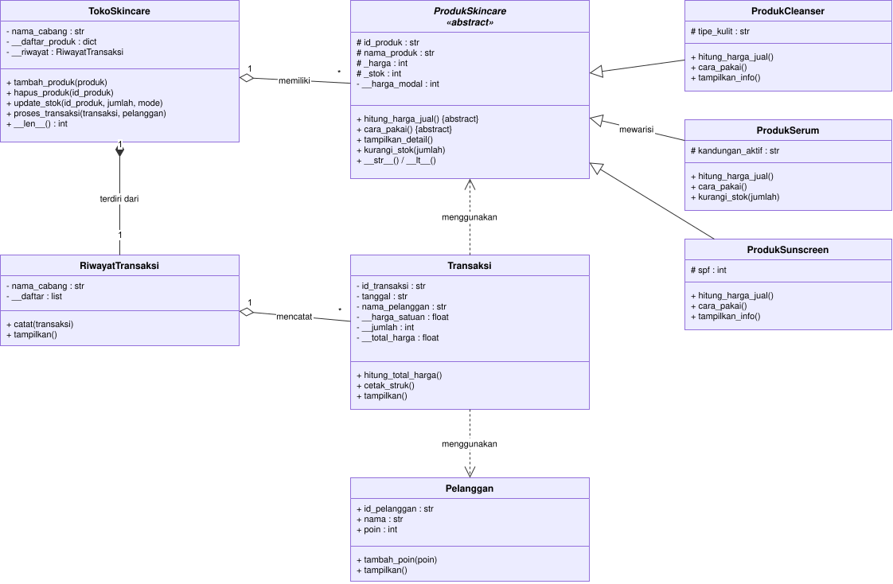
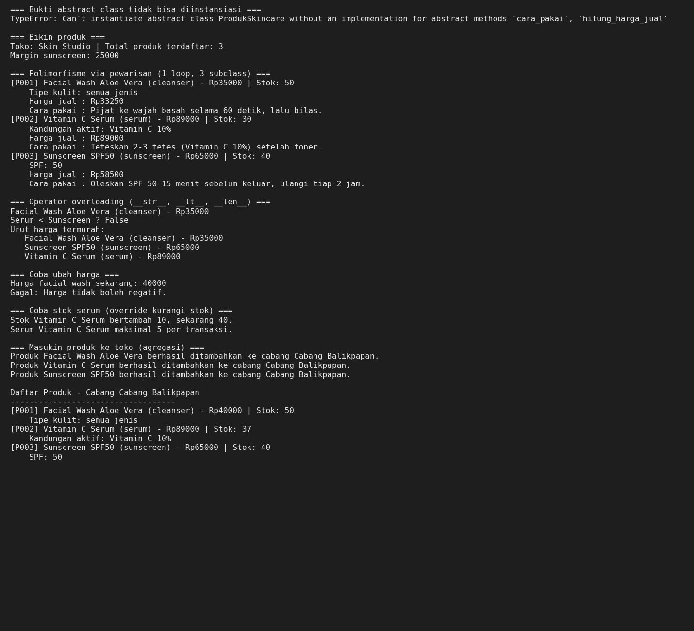
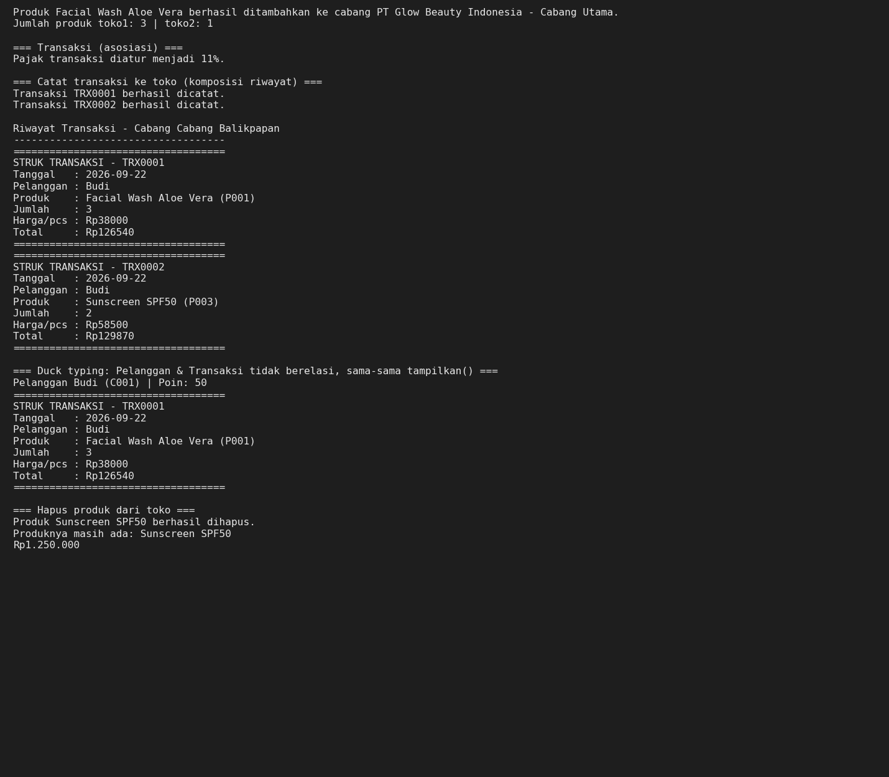

# Skin Studio – Sistem Manajemen Toko Skincare

Program Python berbasis OOP untuk mengelola produk skincare, transaksi, pelanggan, dan riwayat penjualan di cabang toko. Setiap jenis produk (`ProdukCleanser`, `ProdukSerum`, `ProdukSunscreen`) punya harga jual dan cara pakai sendiri-sendiri.

Jalankan dengan: `python main.py`

## 1. Class Diagram



File sumber diagram (bisa dibuka dan diedit di draw.io): [`class_diagram.drawio`](class_diagram.drawio.svg)

Notasi mengikuti modul: panah putus-putus untuk asosiasi, belah ketupat kosong untuk agregasi, belah ketupat penuh untuk komposisi, dan segitiga kosong untuk pewarisan.

| Relasi | Arah | Penjelasan |
|---|---|---|
| **Asosiasi** ("menggunakan") | `Transaksi` ⇢ `ProdukSkincare` dan `Transaksi` ⇢ `Pelanggan` | Produk dan pelanggan hanya diterima sebagai **parameter** `__init__` Transaksi dan dipakai sementara (untuk membaca `hitung_harga_jual()` dan `nama`). Keduanya **tidak disimpan** sebagai atribut, dan keduanya hidup mandiri. |
| **Agregasi** ("memiliki") | `TokoSkincare` ◇— `ProdukSkincare` | Toko menyimpan produk di dict `__daftar_produk`, tetapi produknya dibuat di luar toko lalu dimasukkan lewat `tambah_produk()`. Produk tetap ada setelah `hapus_produk()` dan bisa dipakai di beberapa toko. |
| **Agregasi** ("mencatat") | `RiwayatTransaksi` ◇— `Transaksi` | Riwayat menampung objek `Transaksi` yang dibuat di luar lewat `catat(transaksi)`. Transaksi tetap ada walau riwayatnya hilang. |
| **Komposisi** ("terdiri dari") | `TokoSkincare` ◆— `RiwayatTransaksi` | Riwayat **dibuat di dalam** `__init__` Toko (`self.__riwayat = RiwayatTransaksi(nama_cabang)`) dan bersifat private. Riwayat satu cabang tidak berguna tanpa cabangnya, dan siklus hidupnya mengikuti Toko. |

**Bukti asosiasi di kode:** `Transaksi.__init__` menerima `produk` dan `pelanggan` hanya sebagai parameter. Tidak ada `self.produk` maupun `self.pelanggan`, hanya `self.nama_pelanggan` berupa teks.
```python
def __init__(self, id_transaksi, tanggal, produk: ProdukSkincare, jumlah, pelanggan: Pelanggan = None):
    self.__harga_satuan = produk.hitung_harga_jual()                    
    self.nama_pelanggan = pelanggan.nama if pelanggan else None          
```

### Agregasi vs Komposisi

Keduanya sama-sama hubungan *has-a* ("punya"). Bedanya ada pada dua hal: **siapa yang membuat objek bagian** dan **apa yang terjadi pada bagian itu ketika pemiliknya hilang**.

| Pertanyaan | Agregasi: `TokoSkincare` ◇— `ProdukSkincare` | Komposisi: `TokoSkincare` ◆— `RiwayatTransaksi` |
|---|---|---|
| Siapa yang membuat objek bagian? | Dibuat **di luar** toko, lalu dimasukkan lewat `tambah_produk()` | Dibuat **di dalam** `__init__` toko |
| Boleh dipakai pemilik lain? | Boleh. `produk1` dipakai `toko1` dan `toko2` sekaligus | Tidak. Riwayat itu private milik satu cabang |
| Jika pemilik dihapus? | Produk tetap hidup | Riwayat ikut hilang |
| Masuk akal berdiri sendiri? | Ya, produk tetap ada walau tidak dijual di toko mana pun | Tidak, riwayat transaksi cabang tidak berarti tanpa cabangnya |

**Bukti agregasi di kode:** produk dibuat dulu, baru "dipinjamkan" ke toko, dan tetap ada setelah dikeluarkan dari toko.
```python
produk3 = ProdukSunscreen("P003", ...)  
toko1.tambah_produk(produk3)            
toko2.tambah_produk(produk1)            
toko1.hapus_produk("P003")              
print(produk3.nama_produk)               
```

**Bukti komposisi di kode:** toko membuat riwayatnya sendiri dan tidak menerima riwayat dari luar. Riwayat hanya bisa diakses lewat toko karena atributnya private.
```python
class TokoSkincare:
    def __init__(self, nama_cabang):
        self.__riwayat = RiwayatTransaksi(nama_cabang)   
```

**Cara cepat membedakan:** tanyakan *"kalau pemiliknya dihapus, apakah bagiannya masih masuk akal ada?"* Jika ya (produk tetap ada), itu **agregasi**. Jika tidak (riwayat cabang ikut hilang), itu **komposisi**. Analoginya mirip playlist dan lagu: lagu tetap ada saat playlist dihapus (agregasi), sedangkan rumah dan kamarnya tidak terpisahkan (komposisi). Di Python, "hilang" berarti tidak ada lagi variabel yang menunjuk ke objek itu. Produk masih ditunjuk variabel `produk3`, sedangkan riwayat hanya ditunjuk oleh toko, jadi ikut hilang bersama toko.

## 2. Abstraksi

- **Abstract class:** `ProdukSkincare(ABC)` dengan 2 `@abstractmethod`: `hitung_harga_jual()` dan `cara_pakai()`.
- **Subclass:** `ProdukCleanser`, `ProdukSerum`, dan `ProdukSunscreen` mengimplementasikan kedua method itu. Semuanya memakai `super().__init__(...)`, punya atribut unik (`tipe_kulit`, `kandungan_aktif`, `spf`), serta atribut protected (`_harga`, `_stok`) dan private (`__harga_modal`).
- **Method konkret bersama:** `tampilkan_detail()` (template method), `tampilkan_info()`, `hitung_margin()`, `kurangi_stok()`, dan `tambah_stok()`.
- **Bukti:** `ProdukSkincare(...)` langsung memunculkan `TypeError` (lihat screenshot output).

## 3. Polimorfisme

- **Via pewarisan:** `hitung_harga_jual()` dan `cara_pakai()` di-override berbeda (cleanser diskon 5%, serum harga normal, sunscreen SPF ≥ 50 diskon 10%). `ProdukSerum` juga meng-override `kurangi_stok()` (maksimal 5 per transaksi). Semuanya dipanggil lewat satu loop `for p in (produk1, produk2, produk3): p.tampilkan_detail()`, tanpa `if/elif` pengecekan tipe.
- **Duck typing:** `Pelanggan` dan `Transaksi` tidak berelasi pewarisan, tetapi sama-sama punya `tampilkan()`. Keduanya dipanggil lewat fungsi `cetak_dokumen(objek)`.
- **Operator overloading:** `ProdukSkincare.__str__` dan `__lt__` (membandingkan harga, dipakai oleh `sorted()`), serta `TokoSkincare.__len__` (jumlah produk).

## 4. Screenshot Output




Bukti abstract class tidak bisa diinstansiasi ada di baris pertama:
`TypeError: Can't instantiate abstract class ProdukSkincare without an implementation for abstract methods 'cara_pakai', 'hitung_harga_jual'`

## 5. Nilai Plus: SOLID

- **OCP (Open/Closed):** menambah jenis produk baru (misalnya `ProdukToner`) cukup membuat subclass baru dari `ProdukSkincare`. Kode `TokoSkincare` dan `Transaksi` tidak perlu diubah.
- **DIP (Dependency Inversion):** `TokoSkincare` dan `Transaksi` bergantung pada abstraksi `ProdukSkincare` (memanggil `hitung_harga_jual()`, `kurangi_stok()`), bukan pada kelas konkret tertentu. Ini terlihat pada type hint `produk: ProdukSkincare` di `Transaksi.__init__` dan `TokoSkincare.tambah_produk()`, dan produknya di-*inject* dari luar  ..